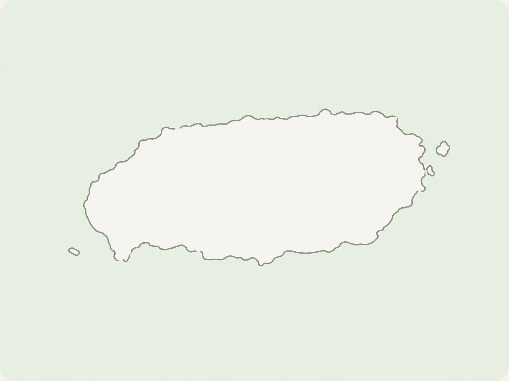
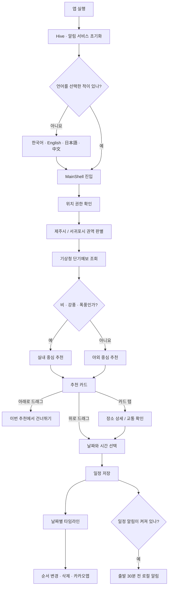
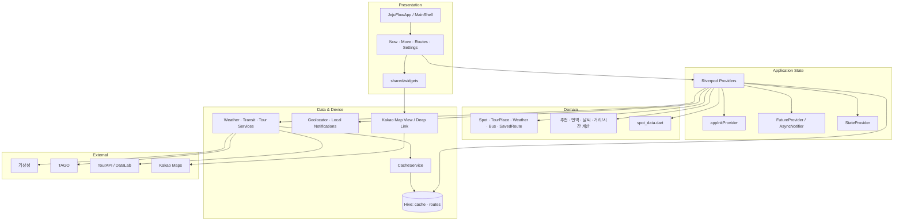
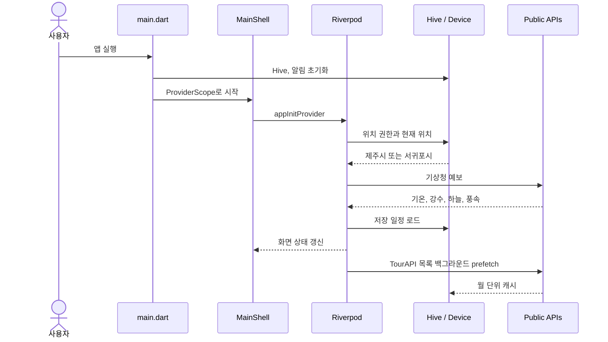

<div align="center">

# JEJUFLOW

### 날씨를 보고, 지금 갈 곳을 고르고, 버스로 이어지는 제주 여행

제주의 수많은 장소를 늘어놓는 대신<br>
**“지금 어디로 가면 좋을까?”**에 답하려고 만든 여행 의사결정 앱입니다.

<p>
  
  
  
  
</p>
<p>
  
  
  
  
  
</p>



</div>

---

## 먼저, 이 앱을 만든 이유

제주 여행 중에는 정보가 부족해서보다 정보가 너무 흩어져 있어서 결정이 늦어질 때가 많습니다. 날씨 앱을 열고, 관광지 후기를 찾고, 버스 도착 시간을 확인하고, 다시 지도 앱으로 넘어가는 사이에 “그래서 지금 어디로 가지?”라는 질문은 그대로 남습니다.

JEJUFLOW는 그 질문을 출발점으로 삼았습니다. 현재 위치를 제주시와 서귀포시 권역으로 나누고, 기상청 예보가 비·강풍·폭풍으로 판단되면 실내 장소를 먼저 보여 줍니다. 마음에 드는 장소는 위로 밀어 일정에 담고, 아래로 밀어 이번 추천에서 넘길 수 있습니다. 장소를 고른 뒤에는 버스 정보와 예상 이동 단계를 확인하고, 저장한 일정은 날짜별 타임라인으로 다시 정리됩니다.

이 프로젝트가 지향하는 것은 “여행 정보 백과사전”보다 **그 순간의 다음 행동을 가볍게 결정하게 해 주는 도구**에 가깝습니다.

## 핵심 기능

| 영역 | 사용자가 할 수 있는 일 | 내부 구현 |
|---|---|---|
| 지금 `Now` | 날씨에 맞는 장소 카드를 위로 밀어 추가하거나 아래로 밀어 넘기기 | 위치 기반 권역, 기상 분류, TourAPI 추천과 로컬 후보 결합 |
| 탐색 `Move` | 관광지·음식점·카페 검색, 필터, 상세와 교통정보 확인 | TourAPI 목록, Riverpod 필터, 상세 API 지연 호출 |
| 일정 `Routes` | 날짜별 일정 확인, 순서 변경, 삭제, 카카오맵 열기 | Hive 영속화, 거리·체류·환승시간 추정, Kakao 딥링크 |
| 설정 `Settings` | 4개 언어 변경, 일정 알림 켜기 | Hive 설정 저장, 로컬 알림 예약 동기화 |
| 오프라인 대응 | 마지막으로 받은 정보로 화면 유지 | 종류별 TTL 캐시와 stale-cache fallback |

## 사용 흐름



하단 탭은 별도 라우터가 아니라 `PageView + PageController`로 구성했습니다. 화면을 밀어서 이동해도 탭 인덱스가 Riverpod의 `tabIndexProvider`와 동기화됩니다. 일정에서 장소를 다시 열 때도 이 Provider를 바꿔 `Move` 탭의 상세 화면으로 연결합니다.

## 화면별 동작

### 1. Now — 지금의 제주에 맞는 한 장

앱이 열리자마자 모든 요청을 한꺼번에 시작하지 않습니다. 메인 셸 진입 후 초기화를 조금 늦춰 첫 렌더링을 우선하고, `Now` 화면도 라이브 데이터를 약 1.2초 뒤에 구독합니다.

1. 기기 위치를 받아 제주시 또는 서귀포시 권역을 고릅니다.
2. 하늘 상태, 강수 형태, 풍속을 `clear / cloudy / rain / windy / storm`으로 분류합니다.
3. `rain`, `windy`, `storm`이면 실내 후보를, 나머지는 야외 후보를 우선합니다.
4. TourAPI 관광지·음식점·카페 후보를 앱 실행 시드로 섞습니다.
5. 일정 초안에 담았거나 아래로 넘긴 장소는 현재 묶음에서 제외합니다.
6. API가 비어 있으면 `spot_data.dart`의 제주 대표 장소가 안전망이 됩니다.

카드를 위로 80px 이상 밀면 일정 추가 창이 열리고, 아래로 80px 이상 밀면 건너뛴 장소 ID가 현재 세션에 남습니다. 새로고침하면 추천 시드와 건너뛴 목록을 초기화해 다른 후보를 볼 수 있습니다.

### 2. Move — 장소를 깊게 살펴보는 탐색

- 관광지, 음식점, 카페를 탭으로 나눕니다.
- 이름 검색과 관광 스타일, 오름, 음식 종류, 카페 스타일 필터를 유지합니다.
- 이미지, 주소, 소개, 운영시간, 휴무일, 대표 메뉴, 이용요금을 필요한 순간에 가져옵니다.
- 정류장 ID가 있는 장소는 TAGO 버스 도착정보를 표시합니다.
- 장소 사진의 대표 색을 뽑아 카드 테마로 활용합니다.
- Kakao JavaScript SDK 지도를 WebView로 보여 주고, 실제 길찾기는 카카오맵 앱이나 웹으로 넘깁니다.

TourAPI는 음식점과 카페를 같은 콘텐츠 타입으로 제공합니다. JEJUFLOW는 카테고리 코드 `A05020900`을 우선하고, 번역 API에서 코드가 부족할 때는 한국어·영어·일본어·중국어의 카페 관련 이름을 보조 기준으로 씁니다. 추천과 전체 탐색이 같은 모델 분류 로직을 공유합니다.

### 3. Routes — 저장 목록이 아니라 하루의 흐름

저장 장소는 `yyyy-MM-dd`로 묶여 날짜 탭과 타임라인으로 표시됩니다. 좌표, 사진, 콘텐츠 ID, 예상 이동 단계를 함께 저장하므로 API 목록이 달라져도 일정의 기본 정보는 남습니다.

하루 일정 계산은 실제 내비게이션 경로가 아닌 빠른 계획용 휴리스틱입니다.

- 장소 간 거리는 Haversine 공식으로 계산합니다.
- 환승 시간은 평균 24km/h 이동과 8분 여유를 기준으로 하며 최소 12분입니다.
- 체류 시간은 해변, 정원, 분화구, 숲, 실내 등 태그에 따라 55~110분으로 잡습니다.
- 앞 일정의 종료와 이동이 다음 예약보다 늦으면 다음 도착 시간을 뒤로 밉니다.
- 편집 모드의 순서 변경은 Hive에도 즉시 반영됩니다.

이 타임라인은 여행 초안을 다듬는 도구입니다. 실제 교통 상황을 반영한 턴바이턴 경로는 이동 직전에 카카오맵에서 확인하는 구조입니다.

### 4. Settings — 여행 중 자주 바꾸는 것만

한국어, 영어, 일본어, 중국어를 지원합니다. 선택 즉시 앱 문구와 언어별 글꼴, TourAPI 서비스 언어가 바뀌며 Hive에 저장됩니다.

일정 알림을 켜면 알림 권한을 요청하고 미래 일정의 30분 전에 로컬 알림을 예약합니다. 일정을 삭제하거나 시간을 바꾸면 기존 알림도 취소하거나 다시 예약합니다. 시간대는 `Asia/Seoul`입니다.

> 방문자 유형(국내/해외) 카드는 현재 화면 상태만 바꾸는 UI 단계입니다. 추천 정책과 영속 설정에 연결하는 일은 후속 과제로 남아 있습니다.

## 아키텍처

JEJUFLOW는 서버가 포함된 모노레포가 아니라 **Flutter 클라이언트 중심 구조**입니다. 화면은 외부 API를 직접 호출하지 않습니다. Riverpod Provider가 상태와 비동기 유스케이스를 조합하고, Service가 통신과 캐시를 맡습니다.



### 시작부터 화면이 채워지기까지



`appInitProvider`는 권역 감지 → 날씨 → 저장 일정 → 알림 동기화 순으로 필수 상태를 준비합니다. 관광지와 음식점 전체 목록은 첫 화면을 막지 않도록 `unawaited` 백그라운드 prefetch로 시작합니다.

## 데이터와 장애 대응

여행 앱은 버스 정류장이나 이동 중에 자주 열립니다. API 실패를 곧바로 빈 화면으로 연결하지 않도록 캐시와 로컬 후보를 두었습니다.

| 데이터 | TTL | 실패 시 동작 |
|---|---:|---|
| 버스 도착정보 | 1분 | 만료 캐시 또는 빈 목록 |
| 권역별 날씨 | 10분 | 만료 캐시, 없으면 맑음/22°C 모의값 |
| 버스 노선 상세 | 1일 | 만료 캐시 |
| TourAPI 장소·상세 | 30일 | 만료 캐시 또는 로컬 대표 장소 |
| 일정·언어·알림 설정 | 없음 | Hive 기기 로컬 저장 |

캐시는 `data`와 `cachedAt`을 JSON으로 보관합니다. JSON이 손상되었거나 스키마가 맞지 않으면 예외를 화면으로 올리지 않고 해당 엔트리를 무시합니다.

현재 위치는 위도 `33.38`을 기준으로 제주시/서귀포시를 간단히 나누는 데만 사용합니다. 위치 서비스가 꺼졌거나 권한이 거부되거나 10초 안에 받지 못하면 제주시가 기본값입니다. 이동 경로를 추적하지는 않습니다.

## 외부 연동

| 연동 | 용도 | 구현 |
|---|---|---|
| 기상청 단기예보 | 기온, 강수형태, 하늘, 풍속 | `WeatherService` |
| TAGO | 정류장별 도착, 노선 상세 | `TransitService` |
| TourAPI | 장소, 이미지, 소개, 운영정보 | `TourService` |
| Tour DataLab | 관련 장소, 혼잡도 보조 데이터 | `TourService` |
| Kakao Maps JS SDK | 앱 내부 지도 | 플랫폼별 `KakaoMapView` |
| 카카오맵 딥링크 | 실제 대중교통 길찾기 | `url_launcher` |

모바일은 공공데이터 API를 HTTPS로 직접 호출합니다. 웹은 CORS 제약 때문에 `JEJUFLOW_API_PROXY`로 지정한 프록시를 거칩니다. 이 저장소에는 프록시 구현이 없습니다.

## 기술 스택

| 구분 | 기술 | 역할 |
|---|---|---|
| UI | Flutter, Material 3 | 모바일/웹 UI |
| 상태 | Riverpod | 동기 상태, API 상태, 일정 영속 상태 조합 |
| HTTP | Dio | 타임아웃과 응답 정책 |
| 저장 | Hive | 캐시, 일정, 설정 |
| 위치 | Geolocator | 권한과 현재 위치 |
| 지도 | Kakao Maps JS SDK, WebView | 앱 내부 지도 |
| 외부 이동 | url_launcher | Kakao 딥링크/웹 fallback |
| 알림 | flutter_local_notifications, timezone | 일정 30분 전 알림 |
| 이미지 | cached_network_image, palette_generator | 이미지 캐시와 대표 색 |
| 다국어 | Flutter localizations, Google Fonts | 4개 언어 문구/글꼴 |

## 프로젝트 구조

```text
JEJUFLOW/
├── lib/
│   ├── main.dart                     # Hive/알림 초기화
│   ├── app.dart                      # 테마, 언어, MainShell
│   ├── features/
│   │   ├── now/now_screen.dart       # 날씨 기반 카드 추천
│   │   ├── move/move_screen.dart     # 검색·필터·상세·일정
│   │   ├── routes/routes_screen.dart # 날짜별 타임라인
│   │   └── settings/settings_screen.dart
│   ├── providers/app_providers.dart  # 상태와 유스케이스
│   ├── core/
│   │   ├── constants/                # 색상, 키, 로컬 장소
│   │   ├── models/                   # 도메인 모델
│   │   ├── services/                 # API, 캐시, 알림
│   │   └── utils/                    # 위치, 날씨, 경로 계산
│   └── shared/widgets/               # 공용 카드·지도·버스 UI
├── test/                             # 단위 테스트
├── assets/                           # 제주 지도 아트워크
├── android/                          # Android 앱/릴리스
├── ios/                              # iOS 연동 소스 일부
├── web/                              # Web/Kakao 지도 브리지
├── docs/                             # 출시/개인정보 문서
├── .env.example
└── pubspec.yaml
```

`app_providers.dart`와 `move_screen.dart`는 현재 책임이 많이 모여 있습니다. 다음 구조 개선에서는 추천, 번역, 탐색, 일정 편집을 각각 Notifier와 위젯 파일로 나누는 편이 테스트와 유지보수에 유리합니다.

## 로컬 실행

### 요구사항

- Flutter `>=3.44.0` (검증 버전 `3.44.6`)
- Dart `>=3.3.0 <4.0.0`
- Android Studio/Android SDK 또는 Chrome
- 공공데이터포털 서비스 키
- Kakao Developers JavaScript 키(앱 내부 지도 사용 시)

```bash
git clone https://github.com/cres17/jejuflow.git
cd jejuflow
flutter pub get
cp .env.example .env
```

```env
WEATHER_API_KEY=
TAGO_API_KEY=
TOUR_API_KEY=
KAKAO_MAP_KEY=
```

- `WEATHER_API_KEY`: 기상청 단기예보
- `TAGO_API_KEY`: 국토교통부 TAGO
- `TOUR_API_KEY`: 한국관광공사 TourAPI
- `KAKAO_MAP_KEY`: Kakao Developers **JavaScript 키**

URL 인코딩된 공공데이터 키도 한 번 디코딩한 뒤 URI를 만듭니다. 이전 `EXPO_PUBLIC_*` 이름도 하위 호환을 위해 읽지만 새 설정에는 위 이름을 권장합니다.

`.env`는 Flutter asset으로 포함하지 않습니다. 실행과 빌드 시 `--dart-define-from-file=.env`로 읽어 `String.fromEnvironment`에 컴파일 타임 값을 전달합니다. 키 파일이 앱 자산 목록에 들어가는 실수를 막으면서 로컬과 CI에서 같은 방식을 쓸 수 있습니다.

Kakao Developers 웹 플랫폼에는 실행 도메인을 등록해야 합니다.

- Android WebView 개발: `http://localhost`
- Flutter Web: 실제 로컬 origin
- 운영 Web: 배포 도메인

```bash
# Android
flutter run --dart-define-from-file=.env

# Web UI
flutter run -d chrome --dart-define-from-file=.env

# Web + API proxy
flutter run -d chrome \
  --dart-define-from-file=.env \
  --dart-define=JEJUFLOW_API_PROXY=https://your-proxy.example/
```

프록시는 `?url=<encoded upstream URL>`을 받아 허용한 공공 API만 전달하도록 제한해야 합니다. 임의 URL을 중계하는 오픈 프록시로 배포하면 안 됩니다.

## 검사와 빌드

```bash
flutter analyze
flutter test
flutter build apk --debug --dart-define-from-file=.env
flutter build appbundle --release --dart-define-from-file=.env
flutter build web --dart-define-from-file=.env
```

Android 릴리스는 `android/key.properties`와 keystore가 필요합니다. 두 파일은 Git에 포함하지 않습니다. 버전은 `pubspec.yaml`의 `version`에서 관리합니다.

## 현재 지원 범위와 한계

| 항목 | 상태 |
|---|---|
| Android | 앱과 릴리스 설정이 포함된 주 대상 |
| Web | UI/Kakao 브리지 포함. 공공 API는 별도 CORS 프록시 필요 |
| iOS | 일부 연동 파일만 존재. 완전한 Xcode 프로젝트가 없어 현재 저장소 그대로는 빌드 불가 |
| 실시간 경로 | 카카오맵에서 확인. 앱 타임라인은 추정치 |
| 다국어 데이터 | 언어별 TourAPI와 규칙 기반 보정. 전문 번역을 완전히 대체하지 않음 |
| 방문자 유형 | 현재 UI 선택만 구현, 추천에는 미반영 |
| API 보안 | 클라이언트 키는 완전한 비밀이 아님. 운영은 키 제한/서버 프록시 권장 |

## 앞으로 다듬고 싶은 부분

- “왜 이 장소인가요?” 추천 근거 UI
- 행정구역 또는 도로 이동시간 기반 권역 판별
- Kakao Mobility Directions 기반 실제 구간 시간
- 방문자 유형, 동행 형태, 예산의 추천 반영
- 큰 Provider/화면 파일의 기능 단위 분리
- 서비스/Notifier 테스트와 GitHub Actions 확대
- iOS 프로젝트 재생성과 현재 설정 병합

## 문서

| 문서 | 내용 |
|---|---|
| [Play Console 제출 가이드](docs/PLAY_CONSOLE_SUBMISSION.md) | Android 제출과 릴리스 체크 |
| [개인정보 처리방침](docs/PRIVACY_POLICY.md) | 위치·저장 데이터·외부 API 정책 |

## 저장소 원칙

`.env`, 서명 키, keystore, 인증서, IDE 설정과 빌드 산출물은 커밋하지 않습니다. 실제 키가 노출되었다면 파일 삭제로 끝내지 말고 제공처에서 폐기 후 재발급해야 합니다.

아직 별도 오픈소스 라이선스 파일은 없습니다. 외부 배포나 재사용 범위를 열 계획이라면 `LICENSE`를 먼저 추가해 조건을 명확히 해 주세요.

---

<div align="center">

좋은 여행 앱은 더 많은 장소를 보여 주는 앱보다,<br>
**지금 한 곳을 고르게 해 주는 앱**이라고 생각합니다.

</div>
