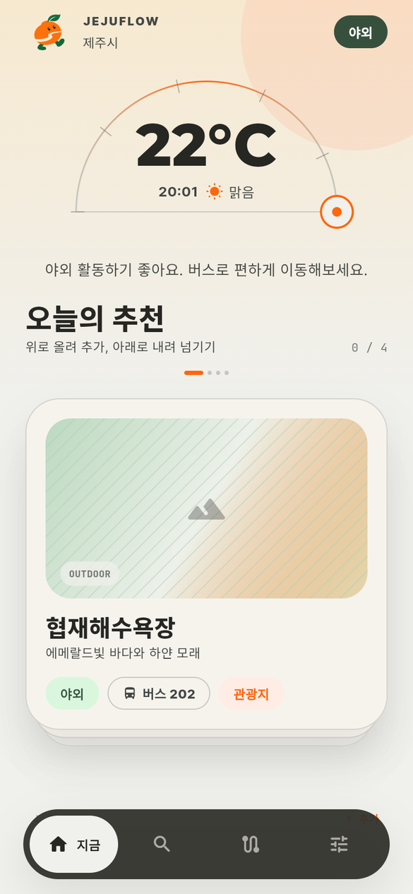
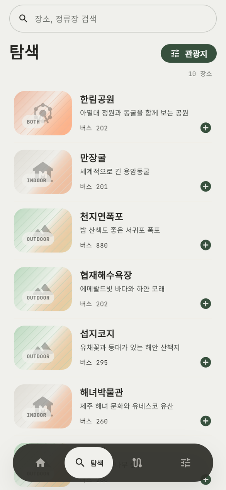
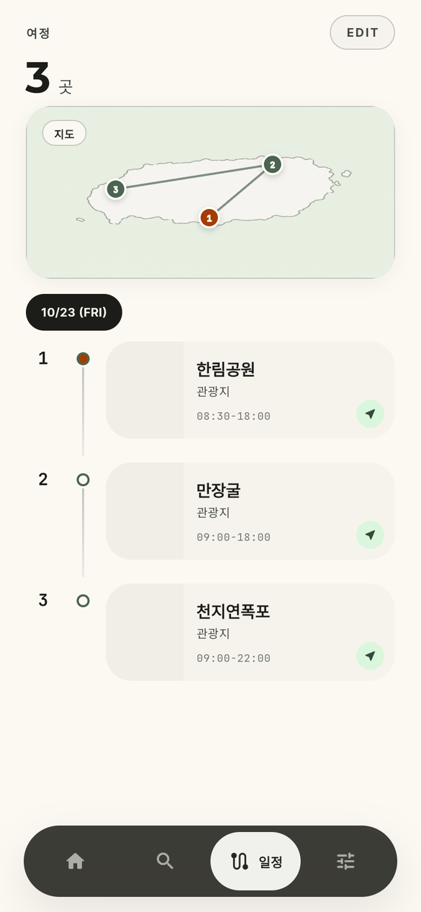
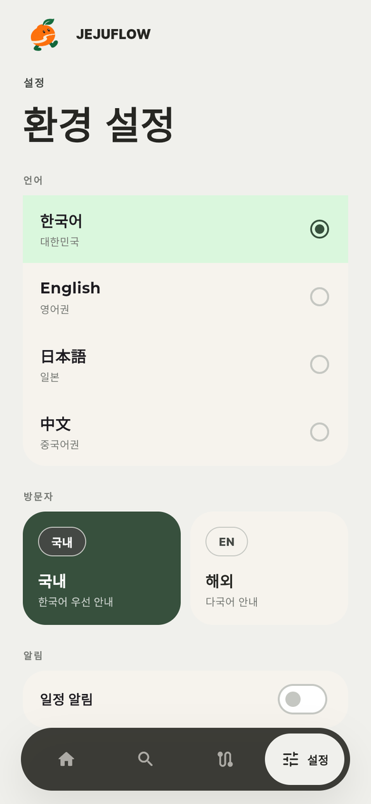
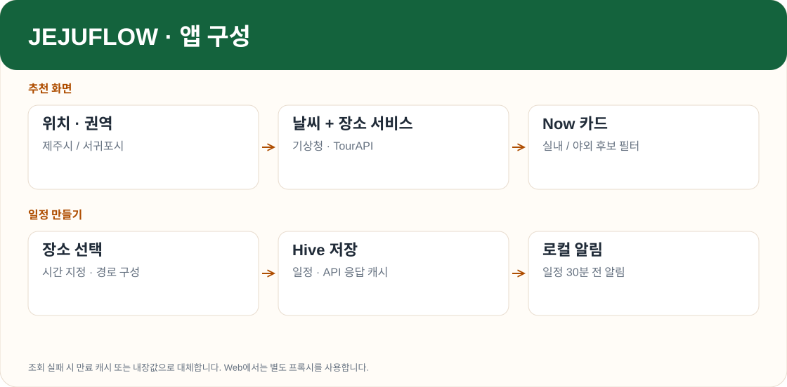

# JEJUFLOW

제주의 날씨와 현재 위치를 바탕으로 갈 곳을 고르고, 날짜별 여행 일정에 담는 Flutter 앱입니다. 관광지·음식점·카페를 탐색하면서 버스 도착 정보를 확인하고 카카오맵 길찾기로 이동할 수 있습니다. 한국어, 영어, 일본어, 중국어를 지원합니다.

## 화면

| Now | Move | Routes | Settings |
|:---:|:---:|:---:|:---:|
|  |  |  |  |

API 키 없이 실행한 웹 빌드입니다. 날씨와 장소는 앱의 기본값이며, 일정에는 탐색 화면에서 선택한 세 장소를 담았습니다.

## 구조



화면은 Riverpod Provider를 구독하고, Service가 공공 API와 Hive 캐시를 다룹니다. 모바일은 공공 API에 직접 요청합니다. Web에서는 CORS 처리를 위해 `JEJUFLOW_API_PROXY`로 지정한 프록시를 사용합니다.

`lib/features/`에 네 탭의 화면이 있고, `lib/providers/app_providers.dart`에 상태와 비동기 조회를 모았습니다. 통신·캐시·알림은 `lib/core/services/`, 날씨·거리·시간 계산은 `lib/core/utils/`에 있습니다.

## 장소 추천

앱을 열면 위치 권한과 좌표를 확인합니다. 위도가 33.38보다 낮으면 서귀포시, 그 외에는 제주시 권역을 사용합니다. 권한을 받지 못하거나 10초 안에 좌표가 오지 않으면 제주시에서 시작합니다.

기상청 단기예보의 강수 형태, 풍속, 하늘 상태로 추천 후보를 거릅니다.

| 예보 | 분류 | 추천 |
|---|---|---|
| 강수 있음 + 풍속 14m/s 이상 | `storm` | 실내 |
| 강수 있음 | `rain` | 실내 |
| 강수 없음 + 풍속 14m/s 이상 | `windy` | 실내 |
| 강수 없음 + 흐림 | `cloudy` | 야외 |
| 나머지 | `clear` | 야외 |

TourAPI 후보를 우선 사용하고 응답이 비어 있으면 해당 권역의 내장 장소로 채웁니다. 관광지는 야외, 음식점과 카페는 실내로 분류합니다. 이미 일정에 넣었거나 넘긴 장소는 빼고 최대 20장의 카드를 구성합니다.

카드를 위로 80px 이상 밀면 일정 추가 대화상자가 열립니다. 아래로 밀면 해당 장소를 넘깁니다. 기준에 못 미친 드래그는 원래 자리로 돌아갑니다.

## 조회와 캐시

API를 호출하기 전에 Hive에서 유효한 캐시를 찾습니다. 새 응답에는 데이터와 저장 시각을 함께 기록합니다. 호출이 실패하면 만료 캐시를 사용하고, 그것도 없으면 내장값을 반환합니다. 기본 날씨인 맑음 22°C는 이 대체 경로의 값입니다.

| 데이터 | 캐시 유효 시간 |
|---|---:|
| 버스 도착 | 1분 |
| 날씨 | 10분 |
| 버스 노선 | 1일 |
| 장소 목록·상세 | 30일 |

버스 정보는 TAGO, 장소 정보는 TourAPI에서 가져옵니다. Tour DataLab은 관련 장소와 혼잡도 보조 지표에 사용합니다. 지도 표시는 Kakao Maps JS SDK를 쓰고, 길찾기는 카카오맵 앱 또는 웹으로 연결합니다.

## 일정과 알림

일정은 Hive의 `routes` 박스에 저장합니다. 장소 간 이동 시간은 Haversine 거리와 평균 24km/h를 기준으로 계산한 뒤 8분을 더하며, 최소 12분으로 잡습니다. 체류 시간은 장소 태그에 따라 55~110분을 배정합니다. 실제 버스 배차나 도로 경로를 반영한 소요 시간은 아닙니다.

알림을 켜면 `Asia/Seoul` 기준으로 일정 출발 30분 전 알림을 예약합니다. 시간을 바꾸거나 일정을 삭제하면 기존 알림을 취소하고 다시 예약합니다.

## 실행

`.env.example`을 복사하고 키를 입력합니다.

| 키 | 발급 서비스 |
|---|---|
| `WEATHER_API_KEY` | 기상청 단기예보 |
| `TAGO_API_KEY` | 국토교통부 TAGO |
| `TOUR_API_KEY` | 한국관광공사 TourAPI |
| `KAKAO_MAP_KEY` | Kakao Developers JavaScript |

```bash
cp .env.example .env
flutter pub get
flutter run --dart-define-from-file=.env
```

웹 실행에는 별도 프록시가 필요합니다.

```bash
flutter run -d chrome --dart-define-from-file=.env \
  --dart-define=JEJUFLOW_API_PROXY=http://127.0.0.1:8787/
```

```bash
flutter analyze
flutter test
```
